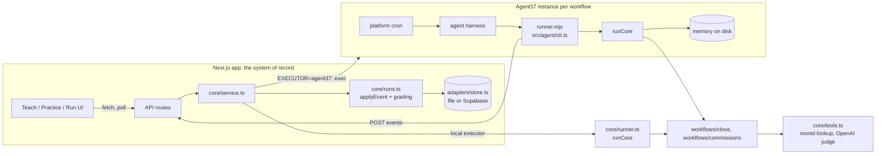

# Architecture

Plain words first: the app keeps one record of every workflow and run. An agent, either inside the app or inside its own Agent37 sandbox, does the work and reports each step back as an event. The app grades practice runs against your past work and holds live runs until you decide the exceptions.

## The pieces

| Layer | Files | Responsibility |
| --- | --- | --- |
| Contract | `src/core/types.ts` | `WorkflowModule`, `Spec`, `Rule`, `Run`, `Review`, `RunContext`. Everything else depends on this. |
| Workflow modules | `src/workflows/*/index.ts` | Domain logic: learn a spec from past examples, apply rules, raise reviews, grade against past work. Deterministic. |
| Engine | `src/core/runner.ts`, `src/core/events.ts` | Runs a module and turns its work into events. Same code runs in-process and in the sandbox. |
| Event applier | `src/core/runs.ts` | The only code that changes a run. Applies events, grades practice outputs, sets final status. |
| Service | `src/core/service.ts` | Teach, start runs, correct, decide, send, reset, baseline, view models. Routes call only this. |
| Store | `src/adapters/store.ts` | `FileStore` (`.data/state.json`) or `SupabaseStore`. Serialized writes per run. |
| Adapters | `src/adapters/{llm,monid,agent37}.ts` | OpenAI, monid CLI, Agent37 REST. Each returns null or throws clearly when not configured. |
| UI | `src/app`, `src/components` | Three tabs; polls the workflow view every 450 ms while a run is active. |
| Sandbox runner | `src/agent/cli.ts` → `dist/runner.mjs` | Fetches the spec from the app, runs the module, posts events back, keeps memory on the sandbox disk. |

## The loop, mechanically

### Teach

`service.teach` calls `module.draftSpec(writtenRules, previousSpec)`. For the close, that:

- builds a vendor to category map by majority vote over your past categorized transactions,
- records the accounts in your books and August's closing balances,
- turns each written line into a `policy` rule (shown, not executed),
- keeps any earlier `correction` and `decision` rules, and bumps the spec version.

The commissions module learns the base rate as the median of commission ÷ amount over plain past lines.

### Practice

`startRun(kind: "practice")` runs the module once per past example with `practice: true`. Practice suppresses review cards and continuity checks. Each example's output is sent as an `example_output` event; `applyEvent` calls `module.grade(exampleId, output)` and stores the case results (4 checks per example, so 12 per workflow). Misses carry row-level diffs (your work vs. the agent's), which the Practice screen shows.

Practice grades **reproduction** of past work: a regression test of the spec, the way you'd check a new hire by having them redo last month. Generalization is measured separately against the hidden `seeds/*/truth/` answer key for the live month (tests and the comparison card), which the agent never reads.

### Correct

`service.correct` compiles the plain-English text into a structured rule:

1. With `OPENAI_API_KEY`: the model picks one of the module's `ruleKinds` and fills its params as JSON. Unknown kinds are rejected.
2. Otherwise, or if that fails: `module.compileRuleOffline`, a small parser for the phrasings in each seed. If it can't parse, the API returns 422 with an example phrasing. It never guesses.

The rule is appended with `origin: "correction"`, the spec version goes up, and a new practice run starts. Because every practice run re-grades every example, a fixed mistake can't silently come back.

Rule kinds today:

| Module | Kind | Effect |
| --- | --- | --- |
| close | `split_by_receipt` | Split a merchant's charges by receipt line using inventory keywords |
| close | `annual_prepaid` | Annual plans at or above a threshold go to Prepaid expenses |
| close | `vendor_category` | Always book a merchant to a category (also created by "Remember this" on a review) |
| commissions | `first_year_value` | Multi-year deals pay on amount × 12 / term |
| commissions | `accelerator` | Bookings above monthly quota pay rate × multiplier |
| commissions | `base_rate` | Override the learned rate |

### Run

`startRun(kind: "manual")` creates a run with the live period's items queued, then either:

- **local executor:** `runCore` in the Next server process, events applied directly; or
- **agent37 executor:** `exec` into the workflow's instance, starting `runner.mjs` in the background with the run id; the runner posts events to `/api/agent/runs/:id/events`.

Inside a run the close module, per statement: lists every account in the file, checks opening + activity = closing to the cent, checks the opening against last month's closing from memory, books each transaction (correction rules, then vendor history, then lookup and review), breaks each Shopify payout into sales, fees, refunds and chargebacks, and ties the payroll register to the bank. Stop conditions raise review cards with evidence, a proposal and two actions. The run ends `needs_review` until every card is decided, then `ready`; `send` is refused before that.

`Run.items[].status` becomes `auto` once its decisions are made, so the UI counts "completed automatically" as items that never had a review.

### Memory

The agent remembers closing balances **by period** (`closingsByPeriod`), so re-running a month still compares against the month before it. Locally memory lives in the store; in the sandbox it's a JSON file on the instance disk (`~/workflow-agent/memory/<workflow>.json`), which persists across sleeps.

## Agent37

Docs: https://www.agent37.com/docs/llms-full.txt. Control plane `https://api.agent37.com` with `Authorization: Bearer sk_live_...`; instance URL `https://{id}.agent37.app` with `X-Agent37-Key`.

| Need | Agent37 feature | Code |
| --- | --- | --- |
| One agent per client | `POST /v1/instances` (template, env, budget, auto_sleep) | `Agent37Client.createInstance` |
| Put the runner and seeds on the box | `PUT /v1/files/content` on the instance URL | `putFile` |
| Run now from the dashboard | `POST /v1/instances/{id}/exec` (backgrounded with nohup) | `service.startRun` |
| Run on schedule, even while asleep | `POST /v1/instances/{id}/crons` with a prompt; the platform wakes the instance and sends the prompt to the harness | `cronPrompt` |
| Remember last month | The instance's persistent disk | runner `fileMemory` |

The cron prompt asks the harness (Hermes by default) to run one exact command and report its last line. The harness's managed model needs a small budget for that turn (`budget.credit_micros` is set at create). The workflow logic itself is deterministic code in `runner.mjs`, so the scheduled run doesn't depend on the harness's reasoning beyond running the command.

`scripts/agent37-provision.ts` does create → upload → `runner.mjs check` → cron → register. **Not yet run against a live account.**

### Why the app is the only writer

The sandbox posts events instead of writing to Supabase directly. One writer means one place that grades, sets status, and enforces "no send before decisions", and the sandbox needs only `APP_URL` and a shared token, not database credentials. The cost: the app must be reachable from the sandbox (InstaCloud deploy or a tunnel).

## Data and seeds

`scripts/generate-seeds.ts` is the only place that knows each firm's true policies, including the ones left out of the written rules on purpose. It writes:

- `periods/` raw inputs per month,
- `examples/` the person's finished work for June to August (practice answer keys),
- `truth/` the answer key for September (comparison and tests only),
- `meta.json` defaults, written rules, suggested corrections, baseline, recorded lookups.

Money is integer cents everywhere, which is how "ties to the cent" stays exact. The generator is deterministic (fixed PRNG seed), so regenerating gives identical files.

## Adding a workflow

1. Create `src/workflows/<id>/index.ts` implementing `WorkflowModule` (see `close` for the full pattern).
2. Generate `seeds/<id>/` with `meta.json`, `periods/`, `examples/`, `truth/` (extend `scripts/generate-seeds.ts`).
3. Register it in `src/workflows/index.ts` (`modules` and `defaultWorkflows`).
4. Add tests in `tests/workflows.test.ts`: practice score before and after corrections, live reviews.

No UI changes are needed.

## Known limits (v1)

- Practice runs always execute in the app process, even with `EXECUTOR=agent37`; only live runs go to the sandbox.
- Live updates poll every 450 ms; Supabase Realtime is the next step.
- `SupabaseStore` caches runs per process. On a multi-instance deploy, runner events landing on different instances could overwrite each other; pin to one instance or move run mutations into the database before scaling.
- The offline rule compiler maps "Amazon" to the seed's `AMZN MKTP` merchant key; the OpenAI path doesn't have this limit.
- The local executor runs jobs as background promises in the Next server. Fine for a demo, not for production (no queue, no retry).
- Supabase store keeps aggregates as JSONB; the normalized schema is in the PRD.
- monid adapter shells out to the CLI and parses loosely; endpoint and response shape unverified.
- No auth on the user-facing API. Agent routes require the shared token.
- Time-saved baselines are placeholders until timed.
