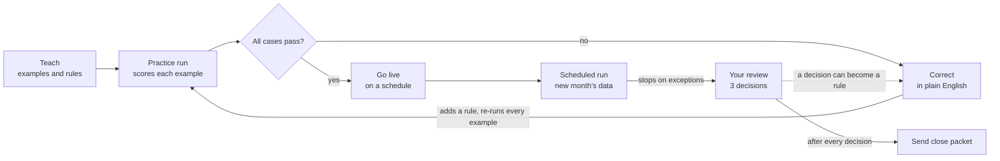
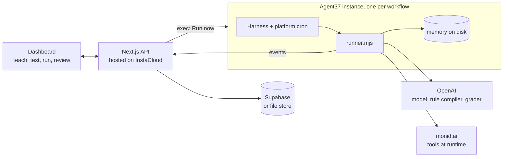

# PRD: Show it once, prove it works, let it run

October 3, 2026 · Dustin Zhu · Source doc: [Claude Docs PRD](https://claude.ai/code/artifact/3d45f8ae-45f8-435a-a1e2-10a9cc5e9366)

> Repo copy of the PRD, updated with what the first build settled. Changes from the original doc are listed in [Build decisions](#build-decisions).

## Summary

We will build an agent that learns how a team does one recurring workflow from a few past examples, proves it matches their work before it touches anything real, then runs on a schedule as that team's own agent.

- **Event:** "Build an Agent" Hackathon, Wednesday October 7, 2026, San Francisco. Build time 2:30 to 4:40 PM; prep before the event is allowed to any degree.
- **Judging signals:** agents you can sell, a workflow you never want to do again, time given back. Prize eligibility requires Agent37 Cloud APIs plus one or more of InstaCloud, monid.ai, OpenAI, Supabase.
- **Working name:** "Show it once" (placeholder).
- **Demo workflows:** month-end close for one Shopify seller, and monthly sales commissions for a B2B SaaS company to prove it generalizes.
- **What users never see:** the word "eval". Under the hood the product builds a company-specific eval harness; on screen it is "your past work", "practice run" and "teach it".

## Problem and pain points

Templatized workflows are already served by funded AI-native SaaS; the open gap is bespoke workflows, where every team does the job a little differently and nobody can prove an agent does it their way.

| | Templatized workflows | Bespoke workflows |
| --- | --- | --- |
| Examples | IT tickets, security questionnaires, AP, expenses, inbox | How our firm closes a client; how we pay commissions; how I prep a board pack |
| Served by today | AI-native SaaS: [Serval](https://www.serval.com/blog/serval%e2%80%99s-next-chapter-raising-75m-to-build-the-new-era-of-enterprise-automation-and-service-management) (IT), [Vanta](https://www.vanta.com/resources/introducing-questionnaire-automation) (questionnaires), Ramp (AP, expenses) | Consultants, offshore teams, spreadsheets, or nobody |
| Why | One product fits thousands of identical customers | Each customer's version differs, so classic SaaS can't make money on it |
| State | Saturated | Open |

**Pain points for the person doing the work:**

1. **Generic agents don't know the house rules.** Plain GPT or Claude with the same files gets the mechanics roughly right but misses local rules (how a vendor's receipts split, which plans are prepaid, when to stop and ask).
2. **No way to know if it's right before trusting it.** Agent builders (Lindy, Zapier Agents, n8n, OpenAI Agent Builder) let you build an agent. None tells a non-engineer whether it matches their past work.
3. **Corrections don't stick.** A fix given in chat is forgotten next run, so the same mistake comes back.
4. **Silent failures are the expensive ones.** Example from real close work: one statement file held a second currency account that was skipped without anyone noticing; another close was reported "done" while a required step never ran.
5. **The work is recurring and deadline-bound.** Close, commissions and reconciliations repeat every month, so every hour of manual work repeats too.

## Users

The primary user is a bookkeeper at a small firm who closes the same workflow for many clients, each with its own rules; the demo client is a Shopify seller.

| Persona | Role in the product | What they want | What they never want to do |
| --- | --- | --- | --- |
| **Primary: Priya, bookkeeper at a 6-person firm** | Teaches and supervises one agent per client | Close 30 clients a month without 30 manual closes; trust the output | Re-explain each client's quirks; re-check every line |
| **Secondary: Client owner (Shopify seller)** | Answers the agent's questions; receives the close packet | Accurate books by the CPA deadline | Dig through statements to explain a deposit |
| **Secondary: Firm partner or CPA reviewer** | Signs off | Proof the work matches firm standards | Find a silent error after the books are sent |
| **Generalization: any ops or finance owner of a recurring workflow** | Teaches their own workflow (the commissions seed shows this) | The same loop for commissions, reconciliations, reports | Write code or test cases |

**Why this user:** the problem is universal ("the money in the bank doesn't match what I sold"), the business is clear (one agent per client is Agent37's pitch), and the per-client rules are exactly the bespoke layer generic tools miss.

## Proposed solution

The product is four steps: teach, test, correct, run; the testing is the differentiator.

| Step | User does | Agent does | Under the hood |
| --- | --- | --- | --- |
| 1. Teach | Provides 3 past examples (inputs plus their finished output) and writes a few sentences of rules | Drafts a workflow spec: steps, rules, stop conditions, what it learned | Examples become test cases with known answers; rules become checks |
| 2. Test | Nothing | Redoes each example (practice run); scores itself | Eval run: per-case and per-check grading |
| 3. Correct | Fixes misses in plain English | Turns each fix into a rule; re-runs every example | Regression set grows; a fixed mistake can't silently return |
| 4. Run | Approves the exceptions it raises | Runs on schedule on new data; stops on what it can't verify | Every production run is checked against the same rules |

**Positioning line:** everyone lets you build an agent; nobody tells you if it's right for your company before it touches real work.

**Design principles:**

- Deterministic where it must be right. Totals, ties and balance checks are code, not model output.
- The agent never asks an open question. Every escalation carries evidence, a proposal and two choices.
- Nothing is sent until the human decisions are made.
- Same components, swappable seed: a new workflow is a module plus a data folder, not a new app.

**Non-goals for the hackathon:**

- Live connections to QuickBooks, banks, Shopify or a CRM (seeded data only; monid lookups are optional).
- Posting entries or sending money anywhere real.
- Multi-user auth, billing, or a general agent builder canvas.
- Teaching from screen recordings (examples and rules only).

## User workflow

The user teaches once, corrects until every practice case passes, then only reviews exceptions on each scheduled run.



The correction loop is where trust is built; the dashed line shows a review decision feeding back as a new rule, so next month's run needs fewer decisions.

## UI/UX flow

Three tabs carry six screens; the judge's path is Run, watch, decide, done, and the human only acts on the Correct and Review screens.

| Screen | What it shows in 3 seconds | Primary action | Human in the loop |
| --- | --- | --- | --- |
| 1. Teach | Past work (3 client-months with their files), rules box, the drafted spec as readable steps | Draft the workflow | User writes rules; reviews the spec |
| 2. Practice results | "Matched your work on 9 of 12 checks", a month by check grid, each miss side by side | Teach it | None yet; shows where it differs from you |
| 3. Correct | Plain-English box with suggested phrasings; the rule it created | Teach it and re-run | User writes the fix |
| 4. Waiting | "146 transactions across 7 statements waiting for close", deadline, manual estimate, schedule chip | Run now | None |
| 5. Agent working | Statement cards with status, live feed of think, tool, check and stop lines, counter "4 of 7 statements" | None, by design | None; it visibly stops on exceptions |
| 6. Your review, then Done | Review cards (problem, evidence, proposal, two choices), then before vs. after, metrics, how calculated, output, plain-model comparison | Send close packet (only after every decision) | User makes 3 decisions; each is logged with who and when |

**Words on screen, never "eval":** past work (eval cases), practice run (eval run), matched your work on 9 of 12 (score), where it did it differently (failed cases), teach it (add a rule and re-test).

**Review card rules:** every card names the problem in one line, shows 3 evidence fields, states what the agent proposes, and offers exactly two verbs (for example "Approve entries" and "Ask the client"). The agent never asks an open question.

## Data model

**Target schema** (normalized, for production). A seed fills it, so swapping workflows never touches UI code.

| Table | Key fields | Purpose |
| --- | --- | --- |
| `workspaces` | id, name, owner | One firm or team |
| `workflows` | id, workspace_id, module_id, name, unit, schedule_cron, agent37_instance_id, status | One taught workflow for one client; maps to one Agent37 instance |
| `workflow_specs` | id, workflow_id, version, steps[], rules[], stop_conditions[], learned | The versioned spec the agent drafted and the user refined |
| `examples` | id, workflow_id, inputs, expected_output, source | Past work; each example is a test case with a known answer |
| `checks` | id, workflow_id, name, kind (deterministic, model_graded), definition, origin | Rules turned into graded checks |
| `runs` | id, workflow_id, spec_version, kind (practice, scheduled, manual, baseline), started_at, finished_at, score, agent_seconds | One run of any kind |
| `run_items` | id, run_id, name, status (auto, needs_review, failed), trace[], checks[] | One statement or rep within a run; trace drives the activity feed |
| `reviews` | id, run_item_id, title, type, evidence[], proposal, actions[2], decision, decided_by, decided_at | Human-in-the-loop cards and their outcomes |
| `corrections` | id, workflow_id, text, rule_id | Plain-English fixes and what they became |
| `baselines` | id, workflow_id, minutes_per_item, fixed_minutes, minutes_per_decision, source | Inputs to the time-saved calculation |

**v1 as built:** three Supabase tables (`workflows`, `runs`, `agent_memory`) holding the same objects as JSONB, see `supabase/migrations/0001_init.sql`, and a file store (`.data/state.json`) when Supabase isn't configured. The TypeScript types in `src/core/types.ts` are the contract either way.

**Seed folder shape** (one per workflow, generated by `npm run seeds`):

```
seeds/<module>/
  meta.json            workflow defaults, written rules, suggested corrections, baseline, recorded tool lookups
  periods/<YYYY-MM>    the raw inputs for each month (statements, or CRM export)
  examples/<YYYY-MM>   your finished work for past months (the answer key practice grades against)
  truth/<YYYY-MM>      hidden answer key for the live month (comparison and tests only, never shown to the agent)
```

## Architecture and sponsor stack

All five sponsors have a real job: Agent37 runs each workflow's agent, Supabase holds the record, OpenAI reasons and grades, monid supplies tools, InstaCloud hosts the app.



The runner in each sandbox posts its events to the app, and the app is the only writer to the store. Totals and ties are checked in code, never left to the model. See [ARCHITECTURE.md](../ARCHITECTURE.md) for the mechanism.

| Sponsor | Job in the product | Visible in the demo as |
| --- | --- | --- |
| [Agent37](https://agent37.com) | One persistent instance per workflow: runner, platform cron, memory on disk | Schedule chip; Run now executes in the sandbox; a second client is a second instance |
| Supabase | System of record | Runs and decisions persist across devices |
| OpenAI | Rule compiler, merchant judgment, the plain-model baseline | The comparison card |
| [monid.ai](https://monid.ai) | Pay-per-call tools the agent picks at runtime | Merchant lookup on an unknown vendor |
| [InstaCloud](https://instacloud.com) | Hosting for dashboard and API | The hosted link judges open |

## Acceptance criteria

The build is done when every box below passes on the demo laptop and on the hosted link.

**Teach**

- [x] The seed's 3 examples and rules produce a spec with steps, rules and stop conditions in under 60 seconds.
- [x] Each example becomes test cases, visible on the Practice screen.

**Test and correct**

- [x] A practice run scores every example and lists each miss side by side: your work vs. agent output, with the failing check named.
- [x] A plain-English correction creates a new rule, and the re-run score is equal or higher.
- [x] A fixed miss stays fixed on every later run (every practice run re-grades every example).

**Run**

- [ ] A scheduled run fires from Agent37 without a click, and the dashboard shows "last run" with its time. (Code and cron prompt written; not yet run against a live Agent37 account.)
- [x] "Run now" starts the same run on demand.
- [x] The activity feed streams think, tool, check and stop lines per item, never a bare spinner. (v1 polls every 450 ms; Supabase Realtime is the next step.)
- [x] All 3 planted exceptions are stopped and raised as review cards; no planted exception is auto-completed.
- [x] Every review card shows evidence, a proposal and exactly two actions; a decision records who and when.
- [x] Send stays unavailable until every review card is decided.
- [x] Closing balances tie to the cent for every auto-completed account (deterministic check).

**Results and proof**

- [x] The Done screen shows before vs. after, items completed automatically, decisions made, and human time eliminated.
- [x] "How this is calculated" shows the formula and the baseline's source.
- [ ] "Compare with plain model" runs the same files through plain OpenAI and scores it on the same checks. (Built; needs an OpenAI key to produce numbers.)
- [x] Switching the seed shows the second workflow on the same components with no code change.

**Sponsors and reliability**

- [ ] Agent37, Supabase, OpenAI, monid.ai and InstaCloud each do real work in the demo path. (Adapters built; live accounts not yet connected.)
- [ ] A recorded replay plays back if a live call fails, labeled as a replay.
- [x] Repeated runs produce the same numbers (deterministic engine, fixed seeds).

## Success metrics

The headline metric is human time eliminated per run, computed from a timed manual baseline; the trust metric is the score gap between this agent and the plain model on the same checks.

| Metric | Definition | Demo target |
| --- | --- | --- |
| Human time eliminated | (items × manual minutes per item + fixed minutes) minus (decisions × minutes per decision) | Baseline from a timed manual pass; currently a placeholder estimate in `seeds/*/meta.json` |
| Matched your work | Practice checks passed ÷ total checks | 9 of 12, then 12 of 12 after two corrections (both seeds) |
| Completed automatically | Items finished with no decision ÷ all items | 4 of 7 statements; 5 of 8 reps |
| Exceptions caught | Planted exceptions raised as review cards ÷ planted | 3 of 3 |
| False completions | Items marked done that fail a check | 0 |
| Gap vs. plain model | This agent's checks passed minus plain OpenAI's, same files | Measured, not assumed; quoted only from a stored run |

**Honesty rules for numbers:** the baseline comes from timing a real manual pass on the seed data; plain-model results come from a stored run; any figure quoted on stage is one we ran more than once.

## Demo plan, risks, open questions

The 3-minute demo shows teach and correct live; everything else runs from prepared seeds.

1. **Hook, 20s.** "Every company has workflows SaaS can't templatize, because everyone does them differently. I built agents for a CPA firm. The hard part was never the work. It was proving the agent did it our way."
2. **Teach, 40s.** Three past closes for one client. Draft the workflow.
3. **Test and correct, 60s.** Practice scores 9 of 12 and shows the Amazon split and the annual plan. Correct both in plain English. Re-run: 12 of 12.
4. **Run, 40s.** "146 transactions across 7 statements waiting." The feed streams; it stops on 3 decisions; approve them; time eliminated appears.
5. **Proof, 20s.** Plain model on the same checks, from a stored run. Flip to commissions. "Replace yourself, and prove it before it touches real work."

**Risks**

| Risk | Effect | Mitigation |
| --- | --- | --- |
| Reads as another agent builder | Judges compare to Lindy, Zapier, OpenAI Agent Builder | Lead with proof (score, regression, plain-model gap), not building |
| Too abstract | Room loses the thread | Open on the concrete close story; reveal generality last |
| Live integration fails on stage | Dead demo | Everything runs offline by default; integrations are additive |
| Plain-model gap smaller than hoped | Proof slide weakens | Measure early; if small, lead with caught exceptions and zero false completions |
| Client data exposure | Confidentiality breach | Synthetic data only; no UA, Oleum or client material |

**Open questions**

- [ ] Product name.
- [ ] How are finalists selected, what is submitted (link, repo, video), and do judges run it? Ask the hosts.
- [ ] Does the shipped agent run on OpenAI only, or may it call other models?
- [ ] Solo or a team; if a team, who owns UI vs. agent vs. seeds?

## Build decisions

| Decision | Why |
| --- | --- |
| Second workflow is sales commissions, not a monid price check | Commissions best shows the thesis: every comp plan is different, which is why commission SaaS needs long implementations. Same engine, different domain. |
| monid is used for merchant lookups in the close | Gives monid a real job in the main demo; recorded lookups keep it offline-safe |
| v1 stores aggregates as JSONB | Shape still moving; the normalized schema above is the target |
| Practice grades reproduction of past work | Honest framing: it's a regression test of the spec. Generalization is checked against the hidden September truth in tests and the comparison card. |
| Offline rule compiler alongside OpenAI | The demo must work with no keys; the offline compiler handles the phrasings in each seed and says so when it can't parse |
